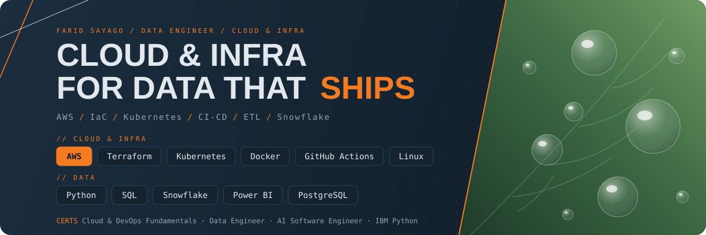

<!-- profile: Farid Sayago -->
<!-- REVIEW: source of truth is CV-eng.md. Items not in the CV are marked REVIEW. -->
<!-- REVIEW: CV lists AWS without specific services. Add concrete services (S3, Glue, Lambda, ECS, etc.) here and in the CV only if you have used them. -->
<!-- palette: navy 1b2d3e / deep 0f1b27 / orange f47b20 / leaf 3f6b45 / light e3e8ec -->

<p align="center">
  
</p>

<p align="center">
  <a href="./README.md"></a>
  <a href="./README.es.md"></a>
</p>

<p align="center">
  
  
  
</p>

<p align="center">
  <a href="https://git.io/typing-svg">
    
  </a>
</p>

<p align="center">
  
  
  
  
  
  
  
  
  
  
  
</p>

> [!NOTE]
> Cloud-first data engineer. Mainly focused on data flows, BI reporting, ETL/ELT pipelines and AI agentic workflows. Nonetheless code reviewing, CI/CD implementations and know how keeps on my own AI dont write my publications or code mainly. just for UI tweaks or tiny refactors.

<h2><samp>⟩ ./about</samp></h2>

I love to process and transform data with complex workflow, mainly backend tecnical guy. Specially for contenerized workflows and cloud first work.

<h2><samp>⟩ ./status</samp></h2>

```text
farid@github:~$ profilectl status

╭─ whoami ─────────────────────────────────────────────────────────────────────╮
│ name       Farid Sayago                                                      │
│ role       Data Engineer | Cloud & Infra | AWS | Azure | Snowflake           │
│ location   Bogotá, Colombia                                                  │
│ languages  English (C1) | Spanish (native) | German (A2)                     │
│ status     Open to opportunities                                             │
│ tagline    Cloud-first data engineering: build it, ship it, keep it running  │
╰──────────────────────────────────────────────────────────────────────────────╯

╭─ pipeline ───────────────────────────────────────────────────────────────────╮
│ sources ────▶ ingest ─────▶ transform ──▶ warehouse ──▶ serve              │
│ OLAP, files   Python        pandas, Dask  Snowflake     Power BI, Grafana    │
│ ──────────────────────────────────────────────────────────────────────────── │
│ platform   AWS, Azure, Docker, Kubernetes (k3s), Linux                       │
│ delivery   Terraform, GitHub Actions, CI/CD                                  │
│ quality    validation, governance, migration checks, data quality            │
╰──────────────────────────────────────────────────────────────────────────────╯

╭─ impact ─────────────────────────────────────────────────────────────────────╮
│ Validated Azure to Snowflake migrations to protect report accuracy           │
│ Cut manual reporting by 40+ hours per month with ETL workflows               │
│ Power BI dashboards and reporting workflows across 14 countries              │
│ Processed 24M+ rows with Dask and pandas                                     │
│ Removed 30+ hours of manual data entry with Power BI and Excel/VBA           │
╰──────────────────────────────────────────────────────────────────────────────╯

╭─ experience ─────────────────────────────────────────────────────────────────╮
│ 07/26 - now   Arbex | BI Trainee                                             │
│               Governed Snowflake data and BI for LATAM commercial teams      │
│               Cloud and Snowflake migration validation, quality controls     │
│                                                                              │
│ 05/26 - now   Kimberly-Clark Professional | KCP Business Insights Trainee    │
│               LATAM commercial insights: BI, SQL, AI-assisted research       │
│               Python/SQL pipeline automation: faster, cleaner reporting      │
│                                                                              │
│ 07/25 - 02/26 Intcomex | Data Analyst                                        │
│               ETL workflows and Power BI for Human Capital, 14 countries     │
│               Replaced manual reports: 40+ hours saved per month             │
╰──────────────────────────────────────────────────────────────────────────────╯

╭─ education ──────────────────────────────────────────────────────────────────╮
│ Universidad Santo Tomás | Economics (2021 - 2026)                            │
│ Platzi | Business Automation and Data Technology (2025 - 2026)               │
╰──────────────────────────────────────────────────────────────────────────────╯

╭─ certifications ─────────────────────────────────────────────────────────────╮
│ Platzi  Cloud and DevOps Fundamentals | Data Engineer | AI Software Engineer │
│         Data Scientist | Data Analysis and Visualization                     │
│ IBM     Python | Machine Learning with Python | Python for Data Science      │
│         AI Fundamentals                                                      │
╰──────────────────────────────────────────────────────────────────────────────╯
```

<!-- REVIEW: "Open to opportunities" is not in the CV. Confirm it is still accurate. -->

<h2><samp>⟩ ./stack --cloud-first</samp></h2>

<div align="center">

<h4><samp>// cloud & infrastructure</samp></h4>


<h4><samp>// data engineering</samp></h4>


<h4><samp>// bi & observability</samp></h4>


<h4><samp>// ai & ml</samp></h4>

<!-- REVIEW: removed TensorFlow, HuggingFace, LangChain (not in CV). Re-add if still current. -->


<h4><samp>// daily environment</samp></h4>


</div>

<h2><samp>⟩ ./projects --active</samp></h2>

<!-- REVIEW: project list and statuses are not in the CV. Confirm they are current. -->

```text
farid@github:~$ tree ./projects --depth=1

./projects
├── wiener-API       RESTful CRUD backend: auth, media, CDN        [WIP]
│   └── FastAPI, SQLAlchemy, JWT, ImageKit
├── wiener-snake     Snake AI with reinforcement learning          [DONE]
│   └── PyTorch, Pygame, CPU-only RL
├── Wiener-git       Git clone built from scratch                  [WIP]
│   └── Python
├── wiener-tickets   Full MLOps data science pipeline              [TODO]
│   └── Stack in design
└── whttp            HTTP server from scratch                      [TODO]
    └── C
```

<h2><samp>⟩ ./stats --github</samp></h2>

<p align="center">
  
  
</p>

<p align="center">
  
</p>

<h2><samp>⟩ ./contact --public</samp></h2>

<!-- REVIEW: email badge added from CV. Remove if you prefer not to expose it publicly. -->
<p align="center">
  <a href="https://www.linkedin.com/in/faridsayago/"></a>
  <a href="https://sayagos.tech/"></a>
  <a href="mailto:farid.s.villa@gmail.com"></a>
</p>

```text
farid@github:~$ echo "Provision it. Ship it. Make it reliable."
```

<p align="center">
  
</p>

<p align="center">
  <sub><samp>Built on Arch Linux, btw. ;) | <a href="https://github.com/Faridsz0605">Faridsz0605</a></samp></sub>
</p>
